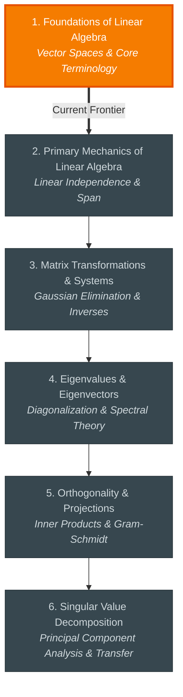

# 🗺️ Linear Algebra: Study Roadmap & Learning Units

A structured progression from foundational axioms to independent problem solving.

---

## 🧭 Topic Sequence Chart

---

## ✅ Learning Unit Checklists

- [ ] **1. Foundations of Linear Algebra** *(Current Focus)*
  - *Concepts:* Vector Spaces & Core Terminology
- [ ] **2. Primary Mechanics of Linear Algebra** *(Upcoming)*
  - *Concepts:* Linear Independence & Span
- [ ] **3. Matrix Transformations & Systems** *(Upcoming)*
  - *Concepts:* Gaussian Elimination & Inverses
- [ ] **4. Eigenvalues & Eigenvectors** *(Upcoming)*
  - *Concepts:* Diagonalization & Spectral Theory
- [ ] **5. Orthogonality & Projections** *(Upcoming)*
  - *Concepts:* Inner Products & Gram-Schmidt
- [ ] **6. Singular Value Decomposition** *(Upcoming)*
  - *Concepts:* Principal Component Analysis & Transfer

---

- [[00_DASHBOARD|← Back to Linear Algebra Hub]] | [[../../00_INDEX_DASHBOARD|Master Hub]]
