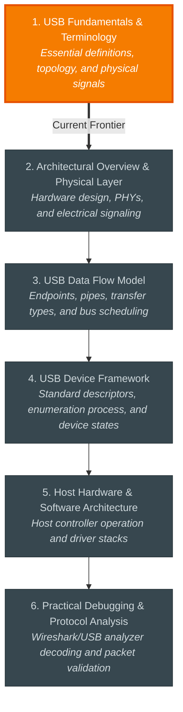

# 🗺️ USB: Study Roadmap & Learning Units

A structured progression from foundational axioms to independent problem solving.

---

## 🧭 Topic Sequence Chart

---

## ✅ Learning Unit Checklists

- [ ] [[lessons/01_usb_fundamentals_terminology|**1. USB Fundamentals & Terminology**]] 👉 **(Current Focus)**
  - *Concepts:* Essential definitions, topology, and physical signals
- [ ] [[lessons/02_architectural_overview_physical_layer|**2. Architectural Overview & Physical Layer**]] *(Upcoming)*
  - *Concepts:* Hardware design, PHYs, and electrical signaling
- [ ] [[lessons/03_usb_data_flow_model|**3. USB Data Flow Model**]] *(Upcoming)*
  - *Concepts:* Endpoints, pipes, transfer types, and bus scheduling
- [ ] [[lessons/04_usb_device_framework|**4. USB Device Framework**]] *(Upcoming)*
  - *Concepts:* Standard descriptors, enumeration process, and device states
- [ ] [[lessons/05_host_hardware_software_architecture|**5. Host Hardware & Software Architecture**]] *(Upcoming)*
  - *Concepts:* Host controller operation and driver stacks
- [ ] [[lessons/06_practical_debugging_protocol_analysis|**6. Practical Debugging & Protocol Analysis**]] *(Upcoming)*
  - *Concepts:* Wireshark/USB analyzer decoding and packet validation

---

- [[00_DASHBOARD|← Back to USB Hub]] | [[../../00_INDEX_DASHBOARD|Master Hub]]
