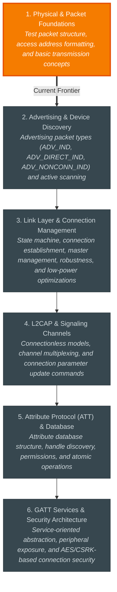

# 🧭 BLE: Study Hub

Welcome to your study space for **BLE**. All roadmaps, diagnostic records, interactive lesson notes, and study guides are preserved here.

---

## 📊 Topic Progress
- **Calibrated Frontier:** Level 0.65 — *1. Physical & Packet Foundations*

```
1. Physical & Packet Foundat   [█████████████░░░░░░░] Current Focus
2. Advertising & Device Disc   [░░░░░░░░░░░░░░░░░░░░] Next Up
3. Link Layer & Connection M   [░░░░░░░░░░░░░░░░░░░░] Queued
4. L2CAP & Signaling Channel   [░░░░░░░░░░░░░░░░░░░░] Queued
5. Attribute Protocol (ATT)    [░░░░░░░░░░░░░░░░░░░░] Queued
6. GATT Services & Security    [░░░░░░░░░░░░░░░░░░░░] Queued
```

---

## 📖 Complete Study Lessons
Read the full textbook-style explanations, circuits, and conceptual notes for each unit:

- [[lessons/01_physical_packet_foundations|📖 Unit 1: 1. Physical & Packet Foundations]] 👉 **(Current Focus)**
  - *Concepts:* Test packet structure, access address formatting, and basic transmission concepts
- [[lessons/02_advertising_device_discovery|📖 Unit 2: 2. Advertising & Device Discovery]] *(Upcoming)*
  - *Concepts:* Advertising packet types (ADV_IND, ADV_DIRECT_IND, ADV_NONCONN_IND) and active scanning
- [[lessons/03_link_layer_connection_management|📖 Unit 3: 3. Link Layer & Connection Management]] *(Upcoming)*
  - *Concepts:* State machine, connection establishment, master management, robustness, and low-power optimizations
- [[lessons/04_l2cap_signaling_channels|📖 Unit 4: 4. L2CAP & Signaling Channels]] *(Upcoming)*
  - *Concepts:* Connectionless models, channel multiplexing, and connection parameter update commands
- [[lessons/05_attribute_protocol_att_database|📖 Unit 5: 5. Attribute Protocol (ATT) & Database]] *(Upcoming)*
  - *Concepts:* Attribute database structure, handle discovery, permissions, and atomic operations
- [[lessons/06_gatt_services_security_architecture|📖 Unit 6: 6. GATT Services & Security Architecture]] *(Upcoming)*
  - *Concepts:* Service-oriented abstraction, peripheral exposure, and AES/CSRK-based connection security

---

## 🗺️ Visual Roadmap



---

## 🗂️ Study Navigation
- [[01_ROADMAP|Full Interactive Roadmap & Checklists]]
- [[02_DIAGNOSTICS|Diagnostic Placement & Assessment Log]]
- [[../../00_INDEX_DASHBOARD|← Return to Master Study Hub]]
