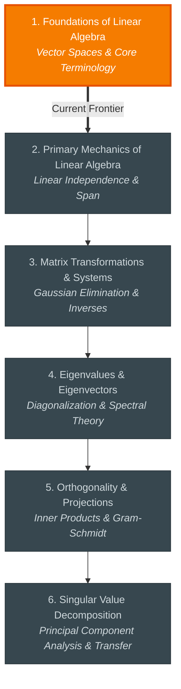

# 🧭 Linear Algebra: Study Hub

Welcome to your study space for **Linear Algebra**. All roadmaps, diagnostic records, interactive lesson notes, and study guides are preserved here.

---

## 📊 Topic Progress
- **Calibrated Frontier:** Level 1.50 — *1. Foundations of Linear Algebra*

```
1. Foundations of Linear Alg   [██████████░░░░░░░░░░] Current Focus
2. Primary Mechanics of Line   [░░░░░░░░░░░░░░░░░░░░] Next Up
3. Matrix Transformations &    [░░░░░░░░░░░░░░░░░░░░] Queued
4. Eigenvalues & Eigenvector   [░░░░░░░░░░░░░░░░░░░░] Queued
5. Orthogonality & Projectio   [░░░░░░░░░░░░░░░░░░░░] Queued
6. Singular Value Decomposit   [░░░░░░░░░░░░░░░░░░░░] Queued
```

---

## 📖 Complete Study Lessons
Read the full textbook-style explanations, circuits, and conceptual notes for each unit:

- [[lessons/01_foundations_of_linear_algebra|📖 Unit 1: 1. Foundations of Linear Algebra]] 👉 **(Current Focus)**
  - *Concepts:* Vector Spaces & Core Terminology
- [[lessons/02_primary_mechanics_of_linear_algebra|📖 Unit 2: 2. Primary Mechanics of Linear Algebra]] *(Upcoming)*
  - *Concepts:* Linear Independence & Span
- [[lessons/03_matrix_transformations_systems|📖 Unit 3: 3. Matrix Transformations & Systems]] *(Upcoming)*
  - *Concepts:* Gaussian Elimination & Inverses
- [[lessons/04_eigenvalues_eigenvectors|📖 Unit 4: 4. Eigenvalues & Eigenvectors]] *(Upcoming)*
  - *Concepts:* Diagonalization & Spectral Theory
- [[lessons/05_orthogonality_projections|📖 Unit 5: 5. Orthogonality & Projections]] *(Upcoming)*
  - *Concepts:* Inner Products & Gram-Schmidt
- [[lessons/06_singular_value_decomposition|📖 Unit 6: 6. Singular Value Decomposition]] *(Upcoming)*
  - *Concepts:* Principal Component Analysis & Transfer

---

## 🗺️ Visual Roadmap



---

## 🗂️ Study Navigation
- [[01_ROADMAP|Full Interactive Roadmap & Checklists]]
- [[02_DIAGNOSTICS|Diagnostic Placement & Assessment Log]]
- [[../../00_INDEX_DASHBOARD|← Return to Master Study Hub]]
