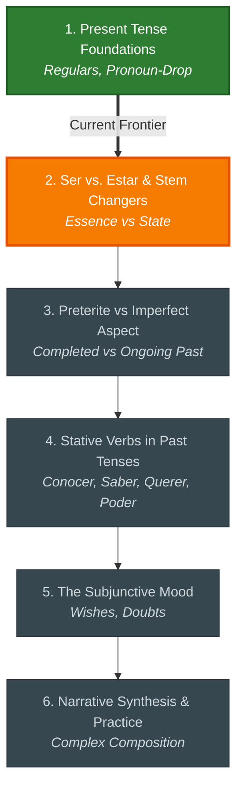

# 🧭 Spanish: Study Hub

Welcome to your study space for **Spanish**. All roadmaps, diagnostic records, and interactive notes are preserved here.

---

## 📊 Topic Progress
- **Calibrated Frontier:** Level 2.65 — *2. Ser vs. Estar & Stem Changers*

```
1. Present Tense Foundations   [████████████████████] Mastered
2. Ser vs. Estar & Stem Chan   [████████████░░░░░░░░] Current Focus
3. Preterite vs Imperfect As   [░░░░░░░░░░░░░░░░░░░░] Next Up
4. Stative Verbs in Past Ten   [░░░░░░░░░░░░░░░░░░░░] Queued
5. The Subjunctive Mood        [░░░░░░░░░░░░░░░░░░░░] Queued
6. Narrative Synthesis & Pra   [░░░░░░░░░░░░░░░░░░░░] Queued
```

---

## 🗺️ Visual Roadmap



---

## 🗂️ Study Navigation
- [[01_ROADMAP|Full Interactive Roadmap & Checklists]]
- [[02_DIAGNOSTICS|Diagnostic Placement & Assessment Log]]
- [[../../00_INDEX_DASHBOARD|← Return to Master Study Hub]]
