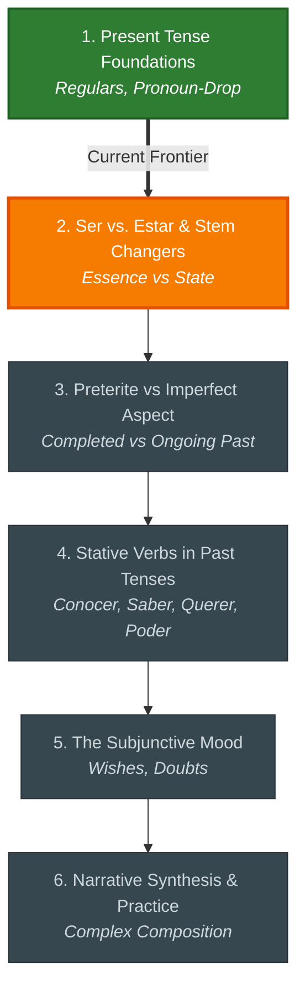

# 🗺️ Spanish: Study Roadmap & Learning Units

A structured progression from foundational axioms to independent problem solving.

---

## 🧭 Topic Sequence Chart

---

## ✅ Learning Unit Checklists

- [x] **1. Present Tense Foundations** *(Mastered)*
  - *Concepts:* Regulars, Pronoun-Drop
- [ ] **2. Ser vs. Estar & Stem Changers** *(Current Focus)*
  - *Concepts:* Essence vs State
- [ ] **3. Preterite vs Imperfect Aspect** *(Upcoming)*
  - *Concepts:* Completed vs Ongoing Past
- [ ] **4. Stative Verbs in Past Tenses** *(Upcoming)*
  - *Concepts:* Conocer, Saber, Querer, Poder
- [ ] **5. The Subjunctive Mood** *(Upcoming)*
  - *Concepts:* Wishes, Doubts
- [ ] **6. Narrative Synthesis & Practice** *(Upcoming)*
  - *Concepts:* Complex Composition

---

- [[00_DASHBOARD|← Back to Spanish Hub]] | [[../../00_INDEX_DASHBOARD|Master Hub]]
